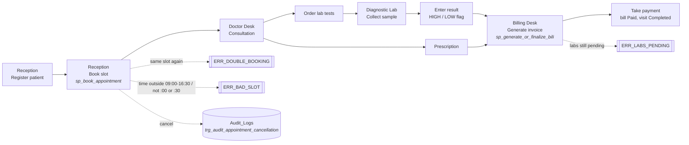

# Digital Health Clinic & Diagnostic Lab Portal

BACSE202 Database Systems · VIT Vellore · Fall 2026-27
Team: Riya (Member 1, database & backend) · Kanishka (Member 2, triggers, views, lab) · Member 3 (Streamlit app, billing, analytics, report)

MySQL 8 database + a four-desk Streamlit app.

## Folder layout

```
clinic_portal/
├── requirements.txt
├── database/
│   ├── 00_setup_all.sql           loads 01 → 05 + 05b in order (resets the database)
│   ├── 01_schema_ddl.sql          Member 1   10 tables, PK/FK/CHECK/UNIQUE (incl. 09:00–16:30 slot CHECK)
│   ├── 02_triggers.sql            Member 2   3 triggers (double booking, auto bill update, audit)
│   ├── 03_procedures_functions.sql Member 1  sp_book_appointment, sp_generate_or_finalize_bill, fn_lab_total
│   ├── 04_views_queries.sql       Member 2   3 views + 10 analytical queries
│   ├── 05_sample_data.sql         Member 2   seed data (5 depts, 10 doctors, 22 tests, 15 patients)
│   ├── 05b_dashboard_history.sql  Member 3   ~150 past visits over 90 days for the Analytics dashboard
│   ├── 06_backend_tests.sql       Member 1   constraint / procedure / cascade test evidence
│   └── 07_trigger_stress_tests.sql Member 2  7 trigger tests: double booking, reschedule, un-cancel, paid-bill block, bill recalculation, audit
├── app/
│   ├── app.py                     Member 3   entry point, sidebar, tab loader
│   ├── db_connection.py           Member 3   connection pool + parameterized helpers
│   ├── reception_tab.py           M1 + M3    register patients, book, cancel
│   ├── doctor_tab.py              M1 + M3    consultation, prescriptions, lab orders
│   ├── lab_tab.py                 Member 2   sample collection and result entry
│   └── billing_tab.py             Member 3   billing desk + analytics dashboard
└── docs/
    ├── ER_Diagram_Chen.drawio     Member 1   ER diagram (Chen notation, weak entities, all attributes)
    ├── Normalization_and_Design_Decisions.md  Member 1   UNF → BCNF proof, CASCADE/RESTRICT reasons
    ├── ER_Diagram_Chen.svg        Member 1   image of the Chen diagram, for the report
    ├── dbms_proj.drawio / .png    Member 1   ER diagram in Crow's Foot notation (key attributes)
    ├── Member1_Documentation.md   Member 1   ER view, design decisions, procedure hand-off, test checklist, viva Q&A
    ├── Clinic_Portal_Wireframes.pdf  Member 3   user flow + wireframes of all four tabs
    ├── Form_Test_Cases.md + Form_Test_Screenshots.pdf          Member 3   Week 2 form validation tests (8/8 pass)
    ├── Integration_Test_Cases.md + Integration_Test_Screenshots.pdf  Member 3   Week 3 integration/trigger tests (10/10 pass)
    ├── Member2_Test_Evidence.docx  Member 2   trigger and billing test evidence with screenshots
    └── TEAM_REVIEW.md             integration review notes
```

## Setup (once)

1. Install MySQL 8 and Python 3.10+.
2. Install the Python libraries:
   ```
   pip install -r requirements.txt
   ```
3. Load the database (this **drops and recreates** `clinic_portal`):
   ```
   cd database
   mysql -u root -p < 00_setup_all.sql
   ```
   If your MySQL client rejects the `SOURCE` lines, log in with `mysql -u root -p` from inside
   `database/` and run `source 01_schema_ddl.sql;` then 02, 03, 04 and 05 the same way.
4. Optional, for test evidence: `mysql -u root -p --force --table clinic_portal < 06_backend_tests.sql`
   Expect exactly 24 `ERROR` lines; every one is labelled `EXPECT ERROR` or `EXPECT ERR_...` in the script.
   Trigger tests: `mysql -u root -p --force --table clinic_portal < 07_trigger_stress_tests.sql` (expect 4 `ERROR` lines: 3 × `ERR_DOUBLE_BOOKING`, 1 × `ERR_BILL_PAID`; the script restores all data).

## Run the app

Set the database login, then start Streamlit from the project root.

Windows (PowerShell):
```
$env:DB_USER="root"; $env:DB_PASSWORD="your_password"
streamlit run app/app.py
```
macOS / Linux:
```
DB_USER=root DB_PASSWORD=your_password streamlit run app/app.py
```
Other settings: `DB_HOST` (default localhost), `DB_PORT` (3306), `DB_NAME` (clinic_portal), `DB_POOL_SIZE` (5).

## User flow (for the report)



Each desk maps to one tab:

| Tab | Who uses it | Database objects it exercises |
|---|---|---|
| Reception | Front desk | `Patients` INSERT (UNIQUE phone), `sp_book_appointment` (slot CHECK, double-booking rule), cancel → audit trigger |
| Doctor Desk | Doctor | `Prescriptions`, `Lab_Orders` INSERT → `trg_update_bill_on_lab_order` |
| Diagnostic Lab | Lab technician | `vw_pending_lab_reports`, status workflow Ordered → Sample Collected → Completed |
| Billing & Analytics | Cashier, manager | `sp_generate_or_finalize_bill` (GENERATE / PAY), GROUP BY / HAVING analytics, `Audit_Logs` |

## Live demo script (5 minutes)

1. **Reception**: register a patient, book a slot for today. Tick *Show booked slots too*, pick the same slot again, press Book → the red `Doctor already has an appointment at this time` message (trigger and procedure rule).
2. **Doctor Desk**: pick that doctor, open the visit, add a medicine, order two tests.
3. **Billing Desk**: choose the visit and press *Generate invoice* → refused, labs still pending (shows the transaction rolled back).
4. **Diagnostic Lab**: collect both samples, enter results; an out-of-range value is flagged HIGH/LOW.
5. **Billing Desk**: *Generate invoice* → consultation + all tests summed in one transaction. Choose a payment mode → *Mark as paid*. Download the paid invoice from *Recently paid*.
6. **Analytics**: revenue by department, busy hours, top tests. Open *Show SQL* under any chart to show the GROUP BY / HAVING query. Open *Audit trail* after cancelling an appointment.
7. **SQL injection**: type `x' OR '1'='1` into the Reception patient search → no rows. Values travel as `%s` parameters, never as SQL text.
