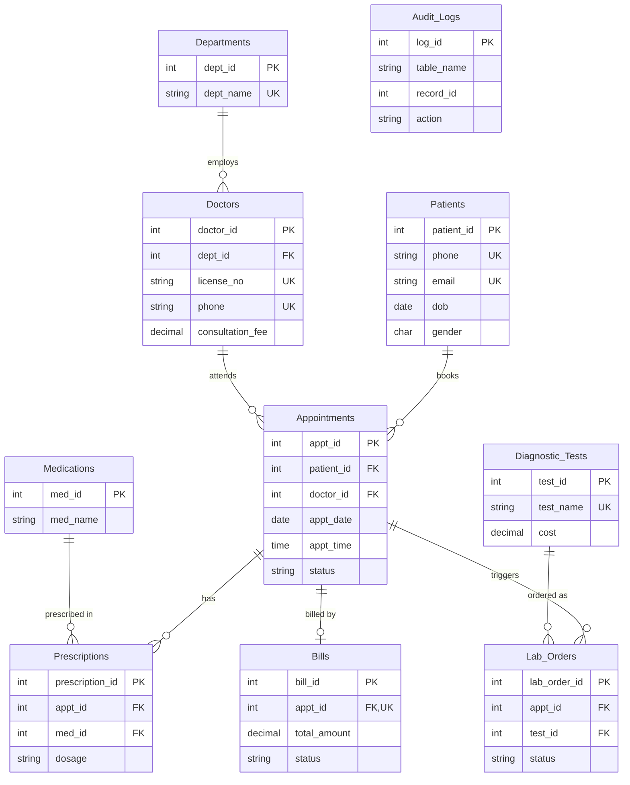

# Member 1: Database Architecture, Backend and Viva Pack
Digital Health Clinic & Diagnostic Lab Portal | BACSE202

## 1. ER diagram (Crow's Foot)

> The report-ready Chen-notation diagram with weak entities and every attribute is in `ER_Diagram_Chen.drawio` / `.svg`. The exported Crow's Foot diagram is `dbms_proj.drawio` / `dbms_proj_drawio.png`. This Mermaid block is the same Crow's Foot view in text form.

Paste the block below into https://mermaid.live to render and export it, or into draw.io (Arrange > Insert > Mermaid). The cardinality symbols are crow's foot: `||` = exactly one, `o{` = zero or many.



**Relationships**
| Relationship | Cardinality | On delete |
|---|---|---|
| Departments → Doctors | 1:N | RESTRICT |
| Patients → Appointments | 1:N | RESTRICT |
| Doctors → Appointments | 1:N | RESTRICT |
| Appointments → Prescriptions | 1:N | CASCADE |
| Medications → Prescriptions | 1:N | RESTRICT |
| Appointments → Lab_Orders | 1:N | CASCADE |
| Diagnostic_Tests → Lab_Orders | 1:N | RESTRICT |
| Appointments → Bills | 1:0..1 (UNIQUE appt_id) | RESTRICT |
| Audit_Logs | no FKs (a log must outlive the rows it describes) | n/a |

**Weak / dependent entities:** Prescriptions and Lab_Orders cannot exist without their Appointment (existence-dependent, hence CASCADE). Prescriptions and Lab_Orders also resolve the M:N relationships Appointment–Medication and Appointment–Test, so they carry their own attributes (dosage, status, result).

## 2. Normalization proof (1NF → 2NF → 3NF/BCNF)

### Unnormalized visit sheet (UNF)
`Visit(visit_id, patient_name, patient_phone, patient_dob, doctor_name, doctor_license, dept_name, doctor_fee, appt_date, appt_time, {medicine, dosage}, {test_name, test_cost}, bill_total)`

Problems: repeating groups (medicines, tests), patient and doctor details repeated on every visit, and `bill_total` is derived.

### 1NF: atomic values, no repeating groups
Split the repeating groups into separate rows, with key (visit_id, medicine) and (visit_id, test_name):
- `Visit(visit_id, patient_*, doctor_*, dept_name, appt_date, appt_time, bill_total)`
- `Visit_Medicine(visit_id, medicine, dosage)`
- `Visit_Test(visit_id, test_name, test_cost)`

### 2NF: no partial dependency on part of a composite key
In `Visit_Test(visit_id, test_name, test_cost)`, `test_cost` depends only on `test_name`, not on the whole key (visit_id, test_name). That is a partial dependency. Fix: move `test_name → test_cost` into `Diagnostic_Tests`, and keep `Lab_Orders(visit_id, test_id)`. The same applies to `Visit_Medicine`, which gives `Medications` and `Prescriptions`.

### 3NF: no transitive dependency
In `Visit`: `visit_id → doctor_license → doctor_name, dept_name, doctor_fee`. Non-key attributes depend on a non-key attribute (the doctor), which is a transitive dependency. Likewise `visit_id → patient_phone → patient_name, patient_dob`. Fix: extract `Doctors`, `Departments` (since `doctor → dept`), and `Patients`. `Appointments` keeps only the FKs.
`bill_total` is derivable (doctor fee plus test costs). It is stored in `Bills` deliberately, as a **snapshot** so a later price change doesn't rewrite old invoices. Justify this in the viva as controlled, documented denormalization.

### BCNF check (every determinant is a candidate key)
| Table | Non-trivial FDs | Determinant a candidate key? |
|---|---|---|
| Departments | dept_id → dept_name, location; dept_name → dept_id | yes (both candidate keys) |
| Doctors | doctor_id → all; license_no → all; phone → all | yes (all candidate keys) |
| Patients | patient_id → all; phone → all; email → all | yes |
| Appointments | appt_id → all | yes. Doctor/date/time is *not* declared unique, because cancelled slots can be reused, so no extra FD is asserted. |
| Prescriptions | prescription_id → all; (appt_id, med_id) → all | yes |
| Lab_Orders | lab_order_id → all; (appt_id, test_id) → all | yes |
| Bills | bill_id → all; appt_id → all | yes |
| Diagnostic_Tests | test_id → all; test_name → all | yes |

All 10 tables are in BCNF.

## 3. Design decisions (for the report)
1. **InnoDB + MySQL 8.0.16+.** It gives real transactions, FK enforcement and enforced CHECK constraints.
2. **Surrogate integer PKs.** They are short, stable and cheap to join on. Natural keys (phone, license) are kept as UNIQUE.
3. **RESTRICT on clinical and financial parents.** Patients, doctors, medications, tests and bills must never disappear silently.
4. **CASCADE only for existence-dependent children** (prescription lines, lab orders).
5. **No UNIQUE(doctor, date, time).** It would block re-booking after a cancellation. Double-booking is prevented by `sp_book_appointment` (row lock plus check) and by Member 2's trigger as a second layer.
6. **Bills stores a fee snapshot.** Intentional denormalization for invoice integrity.
7. **Audit_Logs has no FKs,** so logs survive deletions.
8. **Slot-time CHECK** (`chk_appt_slot`): 09:00-16:30 in 30-minute steps, also validated in `sp_book_appointment` (`ERR_BAD_SLOT`).
9. **Error codes** (`ERR_XXX:`) on every business-rule failure give one predictable format for the UI.
10. **Indexes** on `appt_date`, `patient_id`, `(doctor_id, appt_date, appt_time)` and `Lab_Orders.status` for the schedule, lookup and pending-lab queries. Week 3 review with `EXPLAIN`: the double-booking check uses `idx_appt_slot` and lab lookups use `uq_lab_order`; an extra `Bills(status, paid_at)` index was tried and ignored by the optimizer at this data size, so it was not added.

## 4. Handoff to Member 3 (Streamlit)

```python
from db_connection import call_proc, friendly_error
from mysql.connector import Error

# Booking: pass 0 as a placeholder for the OUT parameter; it comes back filled in
try:
    appt_id = call_proc("sp_book_appointment",
                        (patient_id, doctor_id, appt_date, appt_time, reason, 0))[5]
except Error as e:
    st.error(friendly_error(e))      # shows text after 'ERR_CODE: '

# Billing: action is 'GENERATE' or 'PAY'
res = call_proc("sp_generate_or_finalize_bill", (appt_id, "GENERATE", None, 0, 0))
bill_id, total = res[3], res[4]
```

| Error code | Meaning |
|---|---|
| ERR_PATIENT_NOT_FOUND / ERR_DOCTOR_NOT_FOUND / ERR_APPT_NOT_FOUND | bad id |
| ERR_PAST_DATE | booking date earlier than today |
| ERR_BAD_SLOT | time outside 09:00-16:30 or not on a 30-minute step |
| ERR_DOUBLE_BOOKING | doctor already booked at that time |
| ERR_APPT_CANCELLED | billing a cancelled appointment |
| ERR_LABS_PENDING | lab tests not all Completed |
| ERR_NO_BILL / ERR_ALREADY_PAID / ERR_NO_PAYMENT_MODE / ERR_BAD_ACTION | billing flow errors |

**For Member 2:** your trigger should `SIGNAL SQLSTATE '45000'` with a message starting `ERR_DOUBLE_BOOKING:` and ignore rows where `status='Cancelled'`. Reuse `fn_lab_total(appt_id)` in `trg_update_bill_on_lab_order`, and update a bill only if it exists and isn't `Paid`.

**Setup order on a clean database:** 01 → 02 → 03 → 04 → 05 → 05b (or just run `00_setup_all.sql`), then optionally 06 and 07 for tests. The old `07_migration_slot_check.sql` patch is no longer needed, because `01` already creates `chk_appt_slot`.

## 5. Testing evidence checklist (Day 16)
Run `06_backend_tests.sql` with `--force --table` and screenshot the output. It covers the following:
- **A1–A9:** UNIQUE, CHECK (including the slot-time rule), NOT NULL and FK failures
- **B1–B13 (plus B5b):** booking and billing success and failure, including rollback proof (row count unchanged after B2) and a billing failure leaving no partial bill (B8, B10)
- **C1–C6:** RESTRICT blocks deletes (1451), and CASCADE removes children (C6)

## 6. Viva preparation

**Normalization**
- *What is 1NF/2NF/3NF/BCNF?* Atomic values; no partial dependency; no transitive dependency; every determinant is a candidate key. Use the visit-sheet example above.
- *Is Bills.total_amount a violation?* It is derived, but deliberately stored as a historical snapshot. State it as a justified denormalization.
- *Difference between 3NF and BCNF?* 3NF allows a non-trivial FD whose determinant is not a superkey if the dependent attribute is prime. BCNF doesn't allow that.

**ACID, mapped to this project**
- **Atomicity:** `sp_book_appointment` either inserts or rolls back entirely, and the billing procedure never leaves a half-written bill.
- **Consistency:** FKs, CHECKs, UNIQUEs and procedure validation keep the DB valid before and after each transaction.
- **Isolation:** `SELECT ... FOR UPDATE` on the doctor row serialises concurrent bookings. InnoDB defaults to REPEATABLE READ.
- **Durability:** once COMMIT returns, InnoDB's redo log ensures the data survives a crash.

**TCL**
- `START TRANSACTION` begins, `COMMIT` makes changes permanent, `ROLLBACK` undoes all changes since the start, and `SAVEPOINT x` / `ROLLBACK TO x` undoes part of a transaction.
- DDL statements cause an implicit commit in MySQL. Why does the handler `RESIGNAL`? So the caller still sees the original error after the rollback.

**CASCADE vs RESTRICT**
- RESTRICT (like NO ACTION) refuses the parent delete while children exist. CASCADE deletes or updates the children automatically.
- Project examples: deleting a doctor with appointments is blocked (RESTRICT, test C1). Deleting an unbilled appointment removes its prescriptions and lab orders (CASCADE, test C6).
- *Why RESTRICT on Bills?* Financial records must not vanish when an appointment is deleted.

**Likely extra questions**
- *Procedure vs trigger?* A procedure is called explicitly, takes parameters and can control transactions. A trigger fires automatically on INSERT/UPDATE/DELETE and can't COMMIT or ROLLBACK itself.
- *Why parameterized queries?* They prevent SQL injection because user input is sent as data, never as SQL text.
- *What is a deadlock?* Two transactions wait on each other's locks, and InnoDB rolls one back. Locking the doctor row first in a fixed order lowers the risk.
- *Why indexes?* They speed up lookups and joins, but slow writes slightly and use space.
